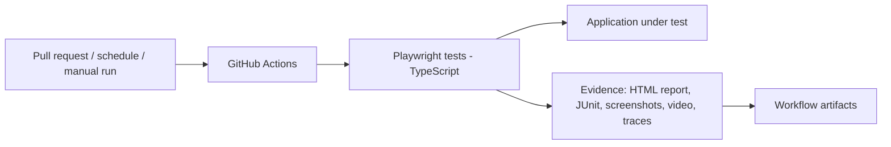

# QA Playwright Demo

A reference implementation of how I structure end-to-end test automation for e-commerce: **Playwright + TypeScript**, run through **GitHub Actions**, with evidence attached to every run.

It targets [SauceDemo](https://www.saucedemo.com), a public practice shop, so everything here is open and independent of any employer.

## What it covers

The flows that carry revenue risk in any online shop:

| Flow | Suite |
|------|-------|
| Login (valid and locked-out user) | `@smoke` |
| Add to cart, checkout, order confirmation | `@smoke` |
| Cart add/remove consistency | `@regression` |
| Checkout validation rules | `@regression` |
| Mocked / failing dependencies | `@regression` |

## Architecture



- **Smoke** (`@smoke`) runs on every pull request in Chromium, fast feedback.
- **Regression** (`@regression` + smoke) runs on a weekday schedule or on demand, across Chromium, Firefox and WebKit.
- Test code and configuration live in Git, so every change to the tests has history and a reviewer.

## Design decisions

- **Prioritize by business impact.** Smoke covers login and the purchase path first; edge cases come after.
- **Page objects** keep selectors in one place, so a UI change is one edit, not twenty.
- **Stable selectors.** Tests use `data-test` attributes, not CSS classes or text that designers change.
- **Mock-first for dependencies.** Third-party calls are blocked globally (`fixtures/base.ts`), and `tests/mocks` shows how to stub or break an API response so UI behaviour can be verified deterministically before running against real environments.
- **Evidence by default.** Screenshots and video are kept on failure, traces on retry, and a JUnit file is produced for test-management tools.
- **Tags over folders for selection.** `@smoke` and `@regression` decide what runs where.

## Run it

```bash
npm install
npx playwright install
npm run test:smoke        # fast checks
npm run test:regression   # regression suite
npm test                  # everything, all browsers
npm run report            # open the HTML report
```

Point the suite at another environment with `BASE_URL=https://example.com npm test`.

## Structure

```
pages/        page objects
fixtures/     shared fixture (third-party stubbing) and test data
tests/smoke/        critical-path checks
tests/regression/   business rules
tests/mocks/        network mocking pattern
.github/workflows/  CI pipeline
```

## Next steps

- API-level tests for the same flows to shrink the UI layer.
- Failure triage: a small script that groups failed tests from the JUnit file by likely cause.
